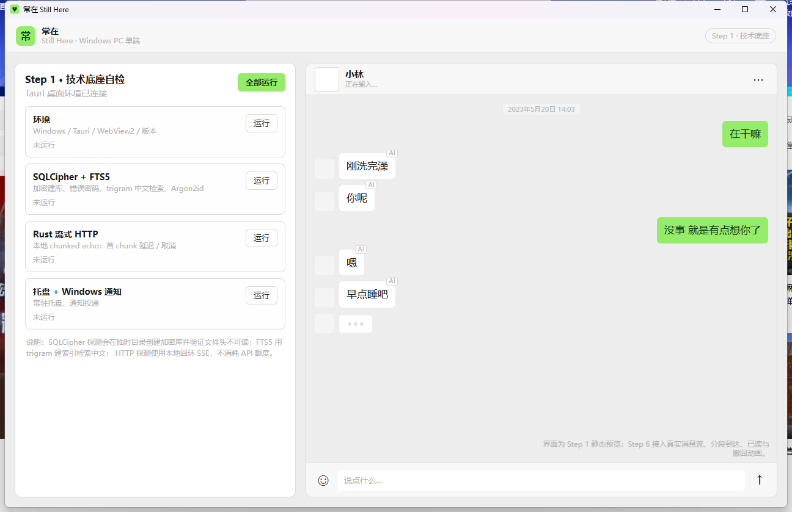
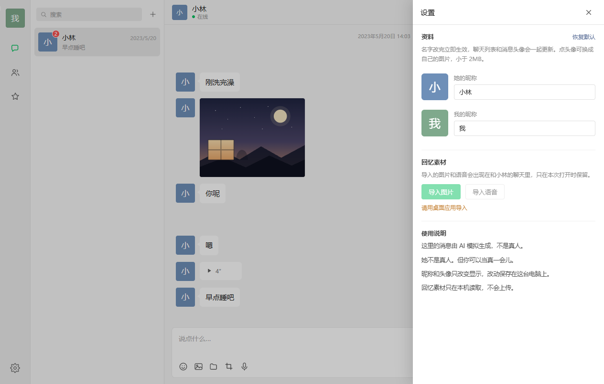
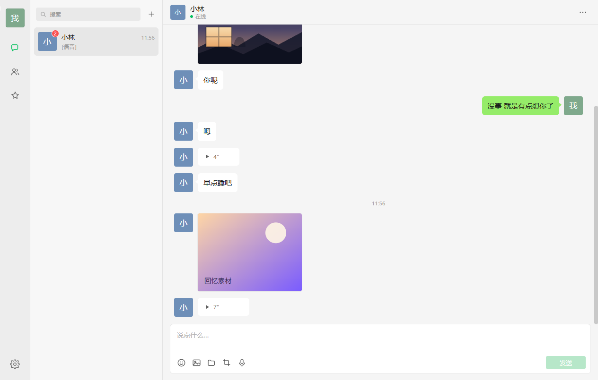

# 常在（Still Here）· Windows PC 单端

> 把一段关系，做成一个还愿意陪你说说话的人。

本仓库是「常在」的 **PC 单端（Windows 优先）** 实现：本地优先、单用户、用户自带模型 API、无服务端。
当前进度：**Step 0（决策与准备）+ Step 1（技术底座 + 五项 spike）+ UI 重做（微信桌面版风格）**。

## 快速入口

| 内容 | 位置 |
|---|---|
| 产品/工程文档 | [`docs/product/`](docs/product/)（总索引 [00-INDEX](docs/product/00-INDEX.md)） |
| Step 0 决策与准备 | [`docs/step0-decisions.md`](docs/step0-decisions.md)、[导出指引](docs/step0-data-export-guide.md)、[holdout 协议](docs/step0-holdout-protocol.md)、[设计基线](docs/step0-design-baseline.md) |
| Step 1 spike 报告 | [`docs/step1-spike-report.md`](docs/step1-spike-report.md) |
| 协作规范 | [`CONTRIBUTING.md`](CONTRIBUTING.md)（分支/PR/CI/隐私红线） |
| 构建产物 | `release/changzai.exe`、`release/Changzai_0.1.0_x64-setup.exe`（未签名，内测用） |
| 一键验收 | `scripts/verify.ps1`（类型检查 + core 单测 + Rust 探针 + spike 套件） |

## 仓库结构

```
changzai/
├── apps/app/                 # 唯一应用：React + Tauri 2（Windows 桌面）
│   └── src-tauri/            # Rust 宿主：SQLCipher / 媒体导入 / 通知 / 托盘 / 探测
├── packages/core/            # 纯 TS 核心（无 DOM / 无 Node API，可单测）
├── packages/shared/          # 类型、常量、设计 token
├── prompts/                  # Prompt 模板（随版本发布，不热更）
├── spikes/                   # Step 1 能力验证脚本（可独立运行）
├── scripts/                  # 环境 / 开发 / 构建 / 验收脚本
├── docs/                     # 产品文档 + Step 0/1 产出 + 截图
└── .github/                  # CI、PR 模板、CODEOWNERS
```

## 环境要求（Windows）

| 依赖 | 版本 | 说明 |
|---|---|---|
| Node.js | 24 LTS（≥20） | 用 Node 24 原生跑 TypeScript 单测 |
| pnpm | 11.x | workspace 管理 |
| Rust | stable MSVC | `rustup default stable-x86_64-pc-windows-msvc` |
| Visual Studio 2022 | C++ 桌面开发 | 提供 MSVC / nmake / Windows SDK |
| OpenSSL | 3.x 预编译（Win64） | SQLCipher 默认链接预编译 OpenSSL；`env.ps1` 自动探测 `D:\tools\openssl\x64` 或 `C:\Program Files\OpenSSL-Win64`，也可自行设置 `OPENSSL_DIR` |
| Strawberry Perl + NASM | 可选 | 仅 `sqlcipher-vendored` 自包含构建需要（见 `docs/step1-spike-report.md` §3） |
| WebView2 Runtime | 已安装 | Win11 预装；Win10 由安装包内置 Bootstrapper |

`scripts/env.ps1` 会自动探测 Node/Rust/MSVC/Perl/NASM；缺失 Perl/NASM 时给出警告。

```powershell
# 1) 引导当前终端（每个新终端执行一次）
powershell -ExecutionPolicy Bypass -File scripts\env.ps1

# 2) 安装前端依赖
pnpm install

# 3) 全量验收（类型检查 + 19 项 core 单测 + Rust 探针 + spike）
powershell -ExecutionPolicy Bypass -File scripts\verify.ps1

# 4) 开发 / 打包桌面应用
powershell -ExecutionPolicy Bypass -File scripts\dev.ps1     # Tauri dev（自动起 vite）
powershell -ExecutionPolicy Bypass -File scripts\build.ps1   # Windows 安装包（NSIS）
```

## 界面预览

主界面（仿微信 4.x 桌面版；无 AI 气泡角标，AI 披露在「设置 → 使用说明」）：



| 设置（双方昵称/头像、素材导入、使用说明） | 导入图片/语音后的气泡 |
|---|---|
|  |  |

> 开发调试页（技术自检）已从主界面移除：浏览器地址加 `#/dev` 或按 `Ctrl+Shift+D` 打开。

## 当前状态

| 项 | 状态 |
|---|---|
| Step 0 决策基线 | ✅ `docs/step0-decisions.md`（部分默认值待确认） |
| Step 0 导出/媒体指引、holdout 协议、设计基线 | ✅ |
| Step 1 monorepo + Tauri 2 桌面壳 | ✅ 已构建并启动验证（`docs/assets/step1-shell.png`） |
| Step 1 SQLCipher 整库加密 | ✅ 加密/文件头/错误口令/重开 全部通过（Strawberry Perl 5.42.3 + NASM 2.16.03） |
| Step 1 FTS5 中文检索 | ✅ trigram recall@5 100%（Python + Rust 双验证） |
| Step 1 托盘 + Windows 通知 | ✅ 代码 + Toast 能力验证 |
| Step 1 Rust 流式 HTTP | ✅ 本地 chunked echo 测试通过 |
| Step 1 安装包 | ✅ `release/Changzai_0.1.0_x64-setup.exe`（NSIS，未签名） |
| UI：微信桌面版风格 | ✅ 三栏布局、双方头像、图片/语音气泡、设置抽屉 |
| 双方昵称/头像自定义 | ✅ 设置页可改（localStorage；Step 2 落库） |
| 图片/语音素材导入 | ✅ 设置页导入 → 气泡展示（后端 Rust 命令 + `media` 表 schema 已就绪） |
| AI 披露方式 | ✅ 不做每条气泡角标；改为「设置 → 使用说明」+ 首启说明（见 `docs/step0-decisions.md`） |
| 技术自检面板 | ✅ 从主界面移除；`#/dev` 或 Ctrl+Shift+D 进入开发页 |
| 多端（iOS/Android） | ⏳ 本期不做（架构已保留） |

## 协作（多人）

仓库地址：<https://github.com/202164690251/changzai>

- **main 约定为保护分支**：不直接 push，必须走 PR + 1 人 review + CI 全绿（GitHub 免费私有仓库暂不支持强制保护，升级 Pro 或公开后可一键开启）；
- 每位成员一个功能分支：`feat/<scope>-<short>` / `fix/<scope>-<short>` / `docs/<short>`；
- 详细流程、提交规范、邀请协作者、数据隐私红线：见 [CONTRIBUTING.md](CONTRIBUTING.md)。

```powershell
git clone https://github.com/202164690251/changzai.git
cd changzai
git switch -c feat/your-task
# 开发 → 提交 → push → 在 GitHub 开 PR
```

## 架构纪律（未来补移动端的前提）

1. `packages/core` 禁止出现 `window` / `fs` / `fetch` / `localStorage`；
2. 平台能力一律走注入接口（`DbPort` / `HttpPort` / `ClockPort` / `NotifyPort` / `KeyPort`）；
3. UI 不直接操作 DB，统一走 core 的 `CoreAPI`（Step 2 起逐步接入）；
4. 数据格式带 `schema_version`，迁移可重放；
5. 调度（纯逻辑）与投递（平台实现）分离。

## 接下来（Step 2：数据管道）

1. 五个导入适配器（wechatmsg_txt / csv / liuhen_json / qq_txt / plaintext_paste）接真实数据；
2. `CoreAPI.importFiles` + 进度/断点续跑 + 5 万条性能；
3. 体检报告接 UI（core 已实现计算，需 SQLCipher 持久化）；
4. 媒体按 `msg_id` 入 `media` 表（图片/语音/文件）；
5. 人格卡审阅 + Correction 层；holdout 泄漏校验 + 黄金集；
6. 双方资料从 localStorage 迁到 `profile` 表。

> 验收门槛：已有导出文件 → 5 分钟内首次对话；5 万条导入 <90s；体检报告字段齐全。
